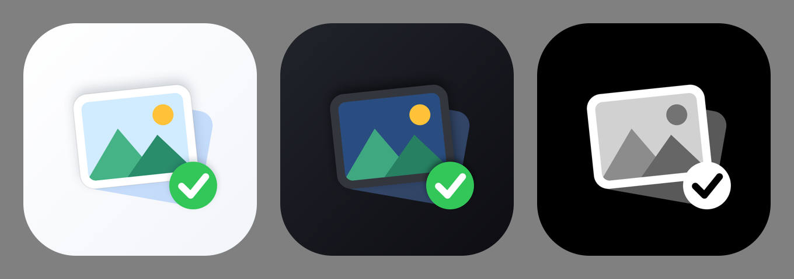

# BestCut

잘 나온 사진만 남기는 iPhone 사진 정리 앱입니다.
*An iPhone photo cleaner that keeps only your best shots.*



## 무엇을 하나요

여행, 주말, 지난달처럼 원하는 기간을 고르면 그 기간의 사진을 iPhone 안에서 분석합니다.

- **비슷한 사진 묶기:** 같은 곳에서 연달아 찍은 사진과 스크린샷을 한 묶음으로 모읍니다.
- **흔들림·어두움 표시:** 흔들리거나 초점이 나간 사진, 너무 어둡거나 밝은 사진, 눈 감은 사진을 표시합니다.
- **베스트 컷 추천:** 묶음마다 가장 잘 나온 사진을 미리 골라 둡니다.
- **고르는 방법 두 가지:** 묶음별로 고르거나, 한 장씩 스와이프합니다. 두 장을 나란히 놓고 함께 확대해 비교할 수도 있습니다.
- **도시별 자동 나누기:** 여러 도시를 다녀온 기간은 도시별로 나눠 폴더로 묶습니다(예: 일본 여행 → 오사카, 도쿄).
- **앨범과 삭제:** 고른 사진은 "[이름] Best" 앨범에 담깁니다. 지울 후보로 직접 표시한 사진만, 마지막에 한 번 더 확인한 뒤 지웁니다.

한국어, English, 日本語, 简体中文을 지원하고 다크 모드와 Liquid Glass 디자인을 씁니다.

## 개인정보

사진은 iPhone 밖으로 나가지 않습니다. 로그인, 광고, 추적이 없습니다. 여행 이름을 추천할 때만 사진의 장소 좌표를 Apple 지도에 보내 도시 이름을 받아 옵니다. 자세한 내용은 [개인정보처리방침](docs/release/privacy-policy.md)에 있습니다.

## 직접 빌드하기

필요한 것: Xcode 27 이상, iOS 26 이상 iPhone 또는 시뮬레이터.

1. 저장소를 내려받습니다.
   ```bash
   git clone https://github.com/woyean5/bestcut.git
   ```
2. `TripPick.xcodeproj`를 Xcode로 엽니다.
3. 본인 iPhone에 설치하려면 Signing & Capabilities에서 본인 Team을 고르고, Bundle Identifier를 겹치지 않는 이름으로 바꿉니다. 자세한 순서는 [iPhone에서 실행하기](docs/release/run-on-iphone.md)에 있습니다.

핵심 로직 테스트:
```bash
scripts/core-test.sh
```

## 구조

| 위치 | 내용 |
|------|------|
| `TripPick/` | SwiftUI 앱 화면 |
| `Packages/TripPickCore/` | 분석, 묶기, 추천, 저장, 사진 보관함 처리(테스트 포함) |
| `scripts/` | 테스트·빌드·번역·아이콘 생성 스크립트 |
| `docs/` | 설계 문서, 구현 계획, 출시 문서 |

## 라이선스

아직 정하지 않았습니다. 코드를 보고 내려받을 수는 있지만, 다른 곳에 다시 쓰거나 배포하려면 먼저 허락을 받아야 합니다.
